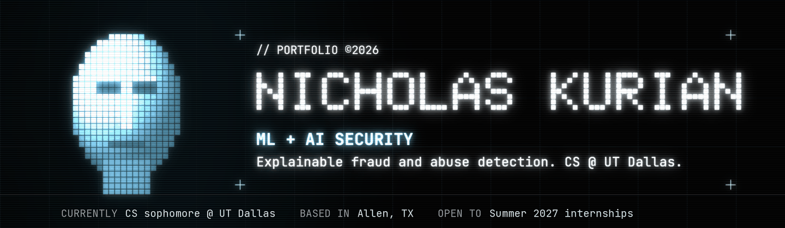
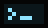

<div align="center">



<h1>
  
  Nicholas Kurian: portfolio
  
</h1>

**A fast, accessible portfolio with no framework and no tracking.**

<samp>// PORTFOLIO ©2026</samp>

Three pages in plain HTML, CSS and JavaScript modules, with raw WebGL2 for the scroll scenes.<br>
It shows my projects, runs a simplified version of Internlog's fraud detector in the page, and still reads with JavaScript off.

<br>


[🚀 Quick start](#-quick-start) · [🎯 What it does](#-what-it-does) · [🧭 How it works](#-how-it-works) · [🧩 Features](#-features) · [🎒 What's inside](#-whats-inside) · [🔒 Security & quality](#-security--quality) · [💬 Commands](#-example-usage) · [❓ FAQ](#-faq)

</div>


<sub><samp>01 / QUICK START</samp></sub>

## 🚀 Quick start

> **You need:** Node 22 and Python 3. Node runs the dev tools. Python runs the local server.

1. 📥 **Clone** the repo: `git clone https://github.com/nicklukekurian-web/portfolio.git`
2. 📦 **Install** the dev tools: `npm install`. They are Playwright, axe, html-validate and Lighthouse CI. The shipped site uses none of them.
3. 🖥️ **Serve** it: `npm run serve`, then open `http://localhost:5173`. The server gives clean URLs (`/proof`, `/contact`) and the 404 page, the same routing as production.
4. ✅ **Check** it: `npm test` and `npm run validate`.

> 💡 **Tip:** add `?debug=fps` to a local URL for a frame-time readout. It does nothing in the production build.


<sub><samp>02 / WHAT IT DOES</samp></sub>

## 🎯 What it does

- 🗂️ **Shows the work.** Home, Proof and Contact, plus a 404 page. Home scrolls through four panels (Internlog, FlyRank ML, NCL Fall 2026, Checkpoint) into three About scenes. Proof has the case studies, six interactive exhibits and a pipeline diagram.
- 🔎 **Runs a detector demo.** A simplified, rule-based port of Internlog's scorer. It scores five signals and lists the reasons for every flag. It is a demo, not the production code.
- 🧪 **Keeps the claims honest.** Tests fail on banned claims, phone numbers and a link that is switched off showing up. FlyRank's Precision@50 numbers are labeled in-sample, and they do not show the trees beat the rule.
- ♿ **Works for everyone.** It follows the OS light or dark theme, honors reduced motion, works with the keyboard, and falls back to static layouts without WebGL or scripts.
- 🛰️ **Stays quiet.** No framework, no bundler, no analytics, no cookies, no contact form and no third-party requests.


<sub><samp>03 / HOW IT WORKS</samp></sub>

## 🧭 How it works

| 🎮 | Step | What happens |
|:-:|---|---|
|  | **1. Plain pages** | Four static HTML files share one header, menu and footer (a test keeps the copies identical). `js/main.js` wires each page and loads its modules after first paint. Copy comes from `docs/build/CONTENT.md`, and links and flags from `data/site.js`. |
|  | **2. One scroll driver** | `js/core/scroll-driver.js` reads `scrollY` once per frame and smooths it. The panels, the About blocks and the scenes are all functions of that one value. The page still scrolls natively. |
|  | **3. Scenes on one canvas** | The assembly line, the gravity shaft and the rocket draw on a single WebGL2 canvas (`js/journey/gl/`) with instanced meshes, a bloom pass and an adaptive resolution. Programs compile in the background. |
|  | **4. Build and ship** | `scripts/build.sh` copies only the public site into `dist/`, fills the NCL numbers from `data/ncl.json` and switches debug tools off. Render serves `dist/` with the headers in `render.yaml`. |


<sub><samp>04 / FEATURES</samp></sub>

## 🧩 Features

<table>
<tr>
<td width="50%" valign="top">

### 🎬 Look and motion
- A voxel mask in the hero turns toward the cursor and leaves an ice-colored particle trail.
- A stack of CRT panels flies in on scroll, then grows into the first scene.
- Text scrambles on hover and as it scrolls in, and the Contact headings type in with a block caret.
- **SCROLL** starts a steady auto-scroll that stops on any input.
- Hero and scene quality drops a tier on slow devices and recovers.

</td>
<td width="50%" valign="top">

### ♿ Built for everyone
- Reduced motion turns the panels into a plain list and the scenes into still images.
- Light and dark themes follow the OS, with a menu toggle.
- Every control works by keyboard, with a skip link and visible focus.
- Text stays readable at 150% size and at 320 px wide.
- Exhibits have a **View data** table for screen readers.

</td>
</tr>
</table>


<sub><samp>05 / WHAT'S INSIDE</samp></sub>

## 🎒 What's inside

| 🎒 | Part | Where |
|:-:|---|---|
|  | **Pages and styles** | `index.html`, `proof.html`, `contact.html`, `404.html`, `css/` |
|  | **Scroll journey and scenes** | `js/journey/` (panels, portal, WebGL2 renderer and three scenes), `js/core/` |
|  | **Detector demo** | `js/detector-demo.js`, the five signals and their thresholds |
|  | **Content and data** | `docs/build/CONTENT.md`, `data/site.js`, `data/*.json` |
|  | **Tests** | `tests/` (Node tests and Playwright specs) |
|  | **Headers and CI** | `render.yaml`, `.github/workflows/`, `.github/dependabot.yml` |
|  | **Build and tooling** | `scripts/`, `tools/make-readme-assets/` |


<sub><samp>06 / SECURITY AND QUALITY</samp></sub>

## 🔒 Security & quality

| ✔️ | Check |
|:-:|---|
|  | **Headers.** A strict CSP (`default-src 'self'`, no inline scripts or styles, Trusted Types, `frame-ancestors 'none'`), HSTS, `nosniff`, `Referrer-Policy`, `Permissions-Policy`, `X-Frame-Options`, and COOP and CORP set to same-origin. |
|  | **No injection paths.** Data-driven text goes through `escapeHtml()`. The detector shows typed text as text nodes and caps each field at 1,500 characters. |
|  | **Unit and content tests.** `npm test` covers escaping, the detector's signals, accuracy rules, links, assets, the shared header and static SEO checks. |
|  | **Browser tests.** Playwright covers layout, keyboard, reduced motion, axe accessibility checks and frame budgets. `npm run matrix` repeats the device checks in Chromium, WebKit and Firefox. |
|  | **Lighthouse CI.** It fails the build if any category drops below 95. |
|  | **CI and scanning.** GitHub Actions runs the unit tests, HTML validation, Playwright and Lighthouse on every push and pull request. CodeQL scans weekly and on every push. Dependabot checks npm and the Actions weekly, and the Actions are pinned to commit SHAs. |


<sub><samp>07 / EXAMPLE USAGE</samp></sub>

## 💬 Example usage

```bash
npm run serve        # local server on :5173 with clean URLs and the 404 page
npm test             # unit, content, link and static-quality tests
npm run validate     # html-validate on all four pages
npm run e2e          # Playwright in Chromium, then the frame-budget tests on their own
npm run matrix       # device matrix in Chromium, WebKit and Firefox
npm run lighthouse   # Lighthouse CI on Home, Proof and Contact
npm run build        # public site into dist/
```

Check the production headers on your machine:

```bash
npm run build
python3 scripts/qa/serve-prod.py 5180     # serves dist/ with the headers from render.yaml
curl -I http://127.0.0.1:5180/proof
```

Rebuild the README art:

```bash
cd tools/make-readme-assets
pip install pillow fonttools brotli
python3 fetch_fonts.py && python3 make_readme_assets.py     # reads the fonts already in assets/fonts
```


<sub><samp>08 / FAQ</samp></sub>

## ❓ FAQ

<details>
<summary><b>Why no framework?</b></summary>
<br>
The site is three pages with a lot of custom drawing, so a framework would add weight without saving code. The shipped site has zero runtime dependencies. Everything in <code>devDependencies</code> is for tests and checks.
</details>

<details>
<summary><b>Is there analytics?</b></summary>
<br>
No. There are no analytics, cookies or third-party requests, and the CSP blocks them. The site stores only your theme choice and a first-visit flag for the loader.
</details>

<details>
<summary><b>The Internlog live demo takes a few seconds to open.</b></summary>
<br>
It runs on a free hosting tier that sleeps when idle. The first load can take a few seconds to wake it up.
</details>

<details>
<summary><b>Where do I change the text or links?</b></summary>
<br>
Copy lives in <code>docs/build/CONTENT.md</code> and links and flags in <code>data/site.js</code>. Tests check the pages against both, so a mismatch fails <code>npm test</code>.
</details>

<details>
<summary><b>Does it work without JavaScript or WebGL?</b></summary>
<br>
Yes. Without scripts the pages read as plain documents and every link works. Without WebGL, or with reduced motion on, Home shows the panels as a list and the scenes as still images.
</details>

<details>
<summary><b>How do I point it at my own domain?</b></summary>
<br>
The domain is <code>nickkurian.dev</code>, set in <code>data/site.js</code>, each page's canonical and social tags, the JSON-LD on Home, <code>sitemap.xml</code> and <code>robots.txt</code>. Change all of those if you fork it, then point DNS at Render.
</details>


<sub><samp>09 / USE IT RESPONSIBLY</samp></sub>

## 🤝 Use it responsibly

- 🍴 **Fork the code, swap the content.** Replace my copy, résumé, links and project claims with your own.
- 🔍 **Check your own headers.** Run `curl -I` against your deployment, because `render.yaml` only applies on Render.
- 🧠 **Don't pass my work off as yours.** The write-ups and résumé are mine, and Internlog was built with Suhaas Voruganti.

<sub><samp>10 / REPO LAYOUT</samp></sub>

## 📁 Repo layout

```text
portfolio/
├── index.html  proof.html  contact.html  404.html
├── css/                    ← tokens, base, components, one file per page area
├── js/
│   ├── main.js             ← entry point, loads each page's modules
│   ├── core/               ← scroll driver, auto-scroll, dev-only switches
│   ├── journey/            ← CRT panels, portal, WebGL2 scenes
│   ├── exhibits/           ← the six Proof exhibits and the pipeline diagram
│   ├── fx/                 ← hero particle trail, debug readout
│   └── components/         ← scramble and type-in text effects
├── data/                   ← site links, NCL and FlyRank numbers, demo data
├── assets/                 ← fonts, images, video, icons, README art
├── scripts/                ← dev server, build, asset and QA scripts
├── tests/                  ← Node tests and Playwright specs
├── tools/
│   └── make-readme-assets/ ← Python that draws the README art
├── docs/build/             ← content, design spec and plan
├── render.yaml             ← static site config and security headers
└── .github/                ← CI, CodeQL, Dependabot
```

<sub><samp>11 / CONTRIBUTING</samp></sub>

## 🌟 Contributing

Bug reports and accessibility fixes are welcome. Open an issue first. Copy and design choices stay mine. If the site helped you build your own, a ⭐ is nice.

<sub><samp>12 / LICENSE AND CREDITS</samp></sub>

## 📜 License & credits

MIT. See [LICENSE](LICENSE).<br>
Site fonts: [Doto](https://github.com/oliverlalan/Doto) and [JetBrains Mono](https://www.jetbrains.com/lp/mono/), both under the SIL Open Font License, self-hosted from Fontsource.<br>
README art: drawn in code in the site's own colors (`css/tokens.css`) and fonts, Doto and JetBrains Mono.<br>
Internlog was built with Suhaas Voruganti.

<div align="center">
<br>
 &nbsp; Built by <a href="https://github.com/nicklukekurian-web">@nicklukekurian-web</a> &nbsp; 
<br><br>

</div>
